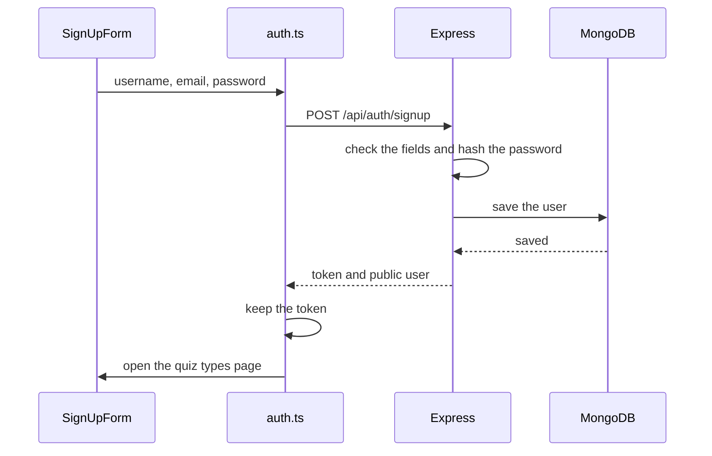

# How QuizUp authentication works

This note explains the account system that was added to QuizUp. It is written for someone who is learning, so you can rebuild the same feature yourself.

The website and the account system are two separate programs. The purple pages you see are the frontend. The new part is a second program, the backend, that receives the form, checks it, and saves the account in MongoDB.

Before this change, Sign Up did not save anything. It only checked that the boxes were not empty, then opened the quiz page. Refreshing the page forgot the person. Now the form sends the answers to the backend, the backend stores the account, and the browser keeps a login ticket so the person stays logged in.

## The two programs

| Program | Folder | Address | Job |
|---|---|---|---|
| Frontend | `src/` | `http://localhost:8081` | The pages: the form, the buttons, the colors |
| Backend | `backend/` | `http://localhost:4000` | The rules: check the password, save the user |

They talk by HTTP. The browser sends a message such as "here is a new user," and the backend answers "saved" or "that email is already used."

If port 8080 is already taken, the frontend moves to 8081. Both addresses are allowed to call the backend.

## What happens when someone clicks Sign Up

1. The form in `src/components/quizup/auth-screen.tsx` reads the three boxes.
2. `src/lib/auth.ts` sends those three values to `http://localhost:4000/api/auth/signup`.
3. `backend/src/routes/auth.ts` checks them. The password must be at least 8 characters, and the username and email must be new.
4. The real password is turned into a hash, a scrambled value that cannot be turned back into the password. MongoDB stores the hash.
5. The backend creates a token, a signed ticket that says "this is user number 123" for 7 days.
6. The browser saves that ticket under the name `quizup_token`, then opens `/quiz-types`.

Login is the same path, except the address is `/api/auth/login`. The backend finds the user by username or email and checks that the typed password matches the stored hash.



## The new backend, file by file

### `backend/package.json`

This file is the shopping list. `npm install` reads it and downloads the tools:

- **express** receives web requests.
- **mongoose** talks to MongoDB.
- **bcrypt** hashes passwords.
- **jsonwebtoken** creates and checks the login ticket.
- **cors** allows the page on port 8080 or 8081 to call the API on port 4000. Browsers block that by default.
- **dotenv** reads `backend/.env`.
- **zod** checks that the form data has the right shape.
- **tsx** and **typescript** let you run TypeScript without a separate build step.

`npm run dev` in that file runs `tsx watch src/index.ts`, which starts the API and restarts it when you edit a file.

### `backend/.env`

This file holds three private settings. It is listed in `.gitignore`, so it is not uploaded to GitHub.

- `MONGODB_URI` is the address of the database, `mongodb://127.0.0.1:27017/quizup`.
- `JWT_SECRET` is the private key used to sign tickets. Anyone who has it can forge a login.
- `PORT` is `4000`.

### `backend/.env.example`

This is the same three names with empty values. It is safe to share, so another person knows which settings to fill in. Copy it to `.env` and fill in the real values on your own computer.

### `backend/tsconfig.json`

This tells TypeScript how strict to be. It does not contain app logic.

### `backend/src/index.ts`

This is the start button. It loads `.env`, stops immediately if the database address or the secret is missing, connects to MongoDB, then starts listening.

```ts
try {
  await mongoose.connect(uri);
} catch (error) {
  console.error("Could not connect to MongoDB. Is it running?");
  console.error(error);
  process.exit(1);
}

const app = createApp();
app.listen(port, () => {
  console.log(`QuizUp API listening on http://localhost:${port}`);
});
```

### `backend/src/app.ts`

This builds the Express app. It allows the frontend origins, reads JSON from requests, and mounts every auth route under `/api/auth`. The last function catches crashes and answers with a message instead of leaving the browser hanging. A request that is not valid JSON gets a 400 reply: "Request body must be JSON."

### `backend/src/models/User.ts`

This is the shape of one account in MongoDB. Each saved user has a username, an email, a `passwordHash`, and the time it was created.

Emails are stored in lowercase, so `Ada@Mail.com` and `ada@mail.com` are the same person. Usernames are unique even if the letters differ only by capitals.

`toPublicUser` builds the object sent back to the browser. That object has the id, username, and email. It leaves out `passwordHash`.

### `backend/src/routes/auth.ts`

This file is the three doors:

- `POST /api/auth/signup` creates an account and answers `201` with a token.
- `POST /api/auth/login` checks the password and answers `200` with a token, or `401` if it is wrong.
- `GET /api/auth/me` answers "who is logged in?" and only works if a valid token is sent.

The numbers are standard replies:

- `400` means the form is wrong.
- `401` means the person is not logged in, or the password is wrong.
- `409` means the username or email is already taken.
- `201` means the account was created.
- `200` means the request succeeded.

Signup hashes the password, saves the user, and returns a token plus the public user:

```ts
const passwordHash = await bcrypt.hash(password, 10);
try {
  const user = await User.create({ username, email, passwordHash });
  res.status(201).json({ token: signToken(user.id), user: toPublicUser(user) });
```

The `10` in `bcrypt.hash` is how many times the password is scrambled. A higher number is slower and harder to guess.

### `backend/src/middleware/requireAuth.ts`

This protects `/api/auth/me`. It looks for a header:

```text
Authorization: Bearer <token>
```

It checks the signature with `JWT_SECRET` and stores the user id for the next function. A missing or fake token gets `401` and the message "Please log in."

`signToken` is also in this file. It puts the user id inside a ticket that expires in 7 days.

## What changed in the frontend

### `src/lib/auth.ts`

This file is new. It is the phone the page uses to call the API.

- `signupRequest` sends the username, email, and password to `/api/auth/signup`.
- `loginRequest` sends the username and password to `/api/auth/login`.
- `setToken` writes the ticket into the browser's `localStorage`, a small store that survives refresh. The key name is `quizup_token`.
- `getToken` reads that ticket back.

Later, when quizzes are saved, a request can attach this ticket to prove who is calling.

If the API is not running, the page shows "Could not reach the server. Is the API running?" If the API answers with an error message, that message is shown on the form.

### `src/components/quizup/auth-screen.tsx`

This file already had the form. Only the submit function changed. It used to jump straight to the quiz page. Now it waits for the API, saves the token, and only then changes page. If the API answers with an error, that text is shown in the red alert under the password. The button is disabled while the request is in progress, so a double click does not create two accounts.

```ts
try {
  const result = signup
    ? await signupRequest({ username, email, password })
    : await loginRequest({ username, password });
  setToken(result.token);
  navigate({ to: "/quiz-types" });
} catch (caught) {
  setError(caught instanceof Error ? caught.message : "Something went wrong.");
}
```

The Google button was left as it was. It still shows a preview message and does not create an account.

### `src/env.d.ts`

This file only tells TypeScript that `VITE_API_URL` is an allowed setting. The project `.env` sets it to `http://localhost:4000`. If that file is missing, `auth.ts` uses the same address anyway.

## Small settings changes

`.gitignore` now ignores `.env` files, including `backend/.env`. Secret values stay on your computer.

`eslint.config.js` ignores the `backend` folder, so the React linter does not try to check the server code.

## What is still a preview

Google sign-in is still a preview. It does not create a real account.

Quizzes are still only remembered while the page is open. Accounts are the only thing this step saves.

## How to rebuild it yourself

Do it in this order. Each step is useless until the one before it works.

1. Install MongoDB and confirm it is running. The database name in the address is `quizup`. MongoDB creates that database when the first user is saved.
2. Create the `backend` folder, `package.json`, and `tsconfig.json`. Run `npm install`.
3. Create `.env` with the database address, a long random `JWT_SECRET`, and port `4000`.
4. Write `User.ts` and check that you understand the three fields before writing any route.
5. Write `index.ts` and `app.ts` with no routes yet. Run `npm run dev` and confirm it prints `QuizUp API listening on http://localhost:4000`.
6. Add signup only. Test it with a tool such as Thunder Client or Postman before touching the React form. Try a short password, a good signup, and the same email a second time.
7. Add login and `/me`, including `requireAuth.ts`.
8. Only then change `auth-screen.tsx` and add `src/lib/auth.ts`. The page should show the backend's error text, and a good signup should land on the quiz types page.
9. Refresh the page and look in the browser's application storage. `quizup_token` should still be there.

To start the API again later, open a terminal in `backend` and run:

```sh
npm run dev
```

The frontend is started from the project folder with the same command:

```sh
npm run dev
```

Keep both terminals open while you try the form.
